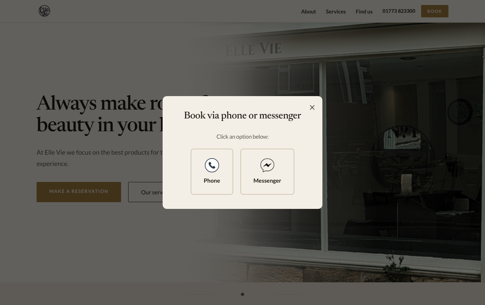
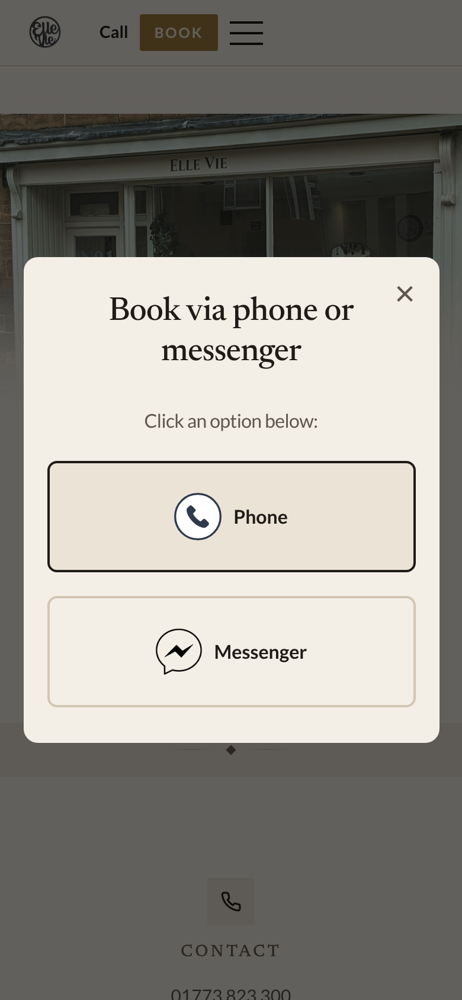
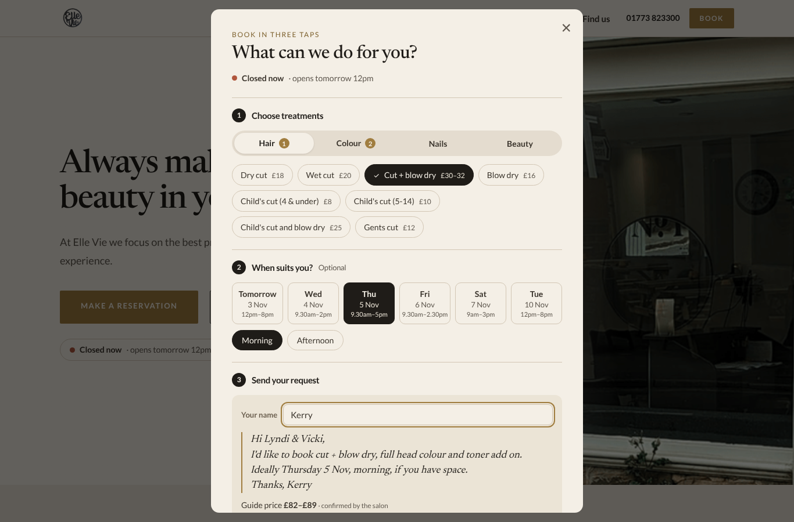
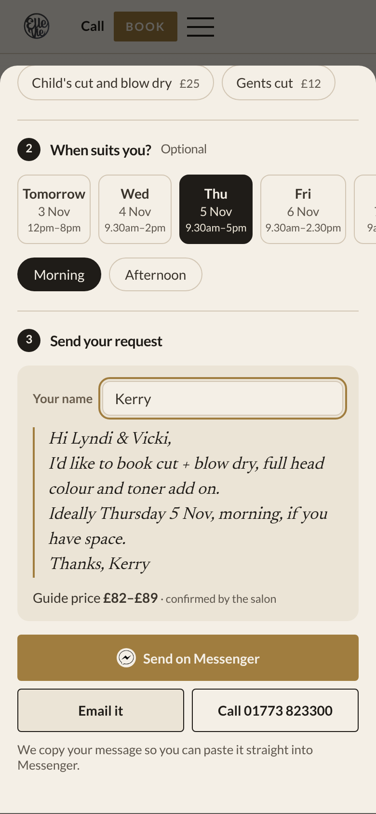
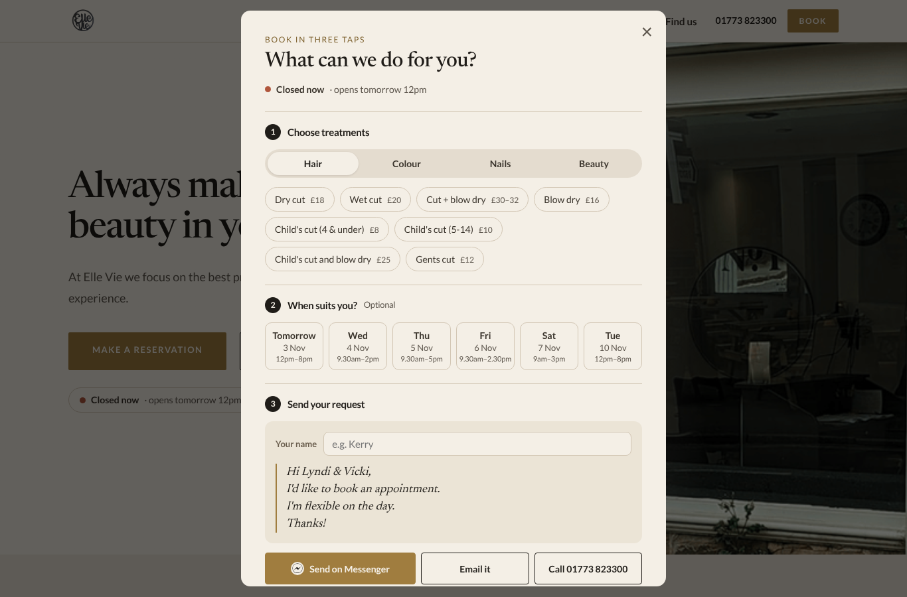
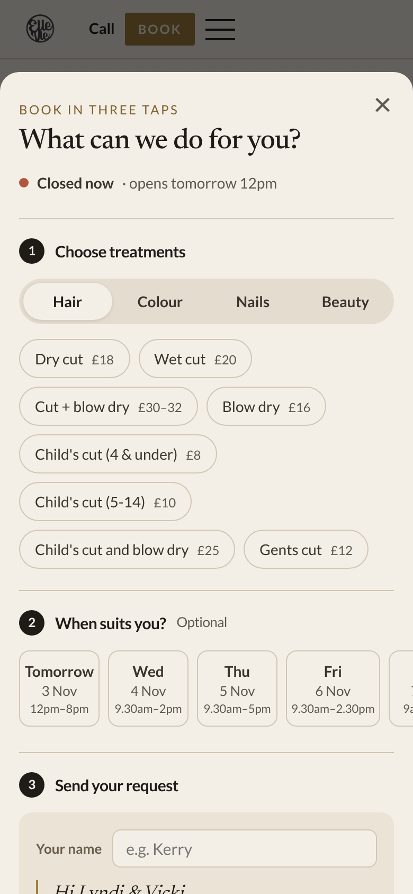
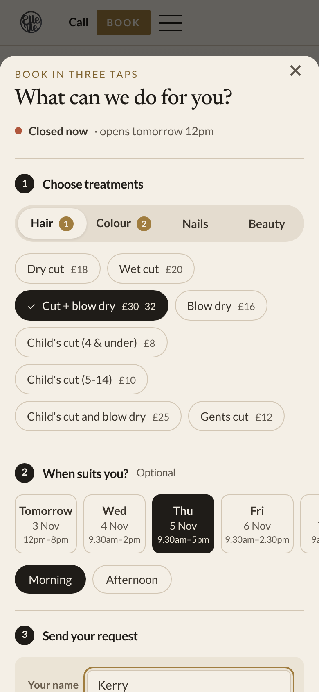
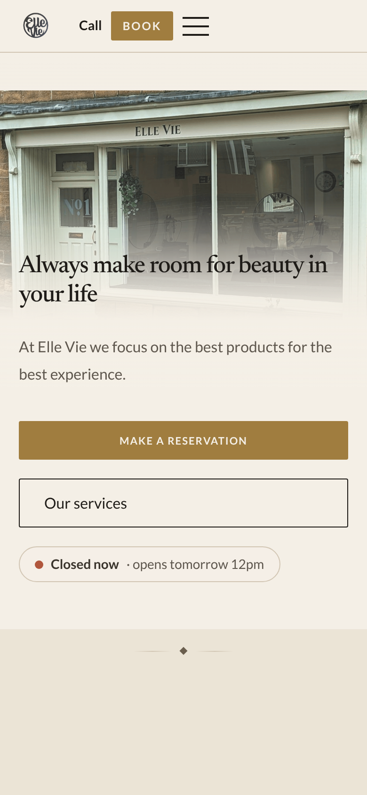
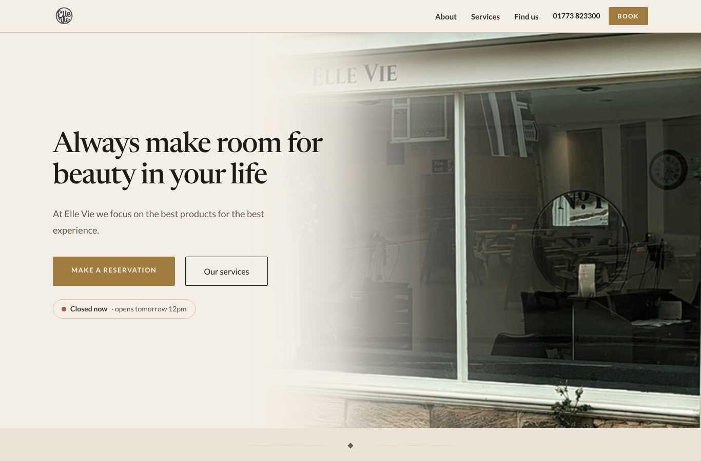
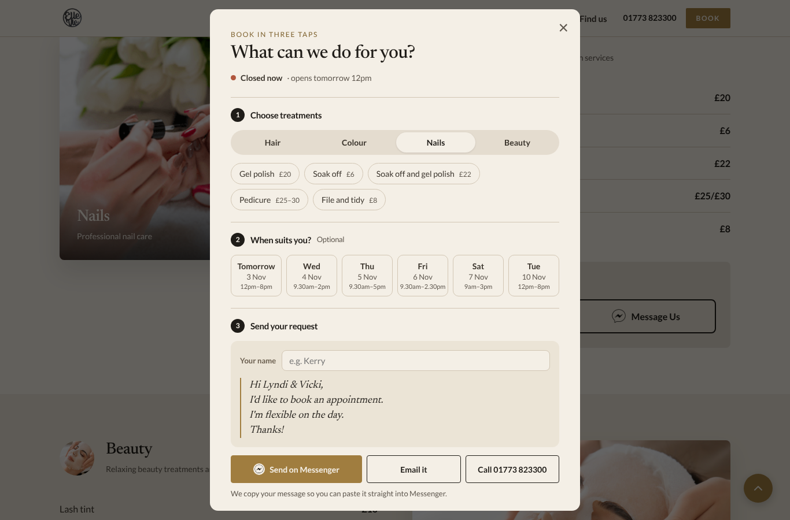

# Future release: Booking concierge

**Status:** Approved idea, parked for later. Not live.
**Proposed:** 2 November 2026
**Pages affected:** all four (Home, Services, About, Find us)

## The problem

Every "Book" and "Make a reservation" button opens a small popup that just asks "phone or Messenger?". The customer then has to work out:

- what to ask for
- what it costs
- when the salon is open

The hours are irregular (closed Sunday and Monday, Wednesday until 2pm, Tuesday until 8pm). People ring when nobody's there, or open Messenger and don't know what to type. That popup is where bookings leak away.

| Before (desktop) | Before (mobile) |
|---|---|
|  |  |

## The change

The popup becomes a three-step request builder.

1. **Choose treatments.** Hair / Colour / Nails / Beauty tabs with tap-to-select chips showing the real prices from the services page. Each tab shows a count of what's been picked.
2. **When suits you?** (optional) Shows only the next six days the salon is open, each with its hours. Picking a day offers Morning / Afternoon / Evening, limited to what fits that day.
3. **Send your request.** The customer adds their first name and a friendly message to Lyndi & Vicki writes itself as they tap. A guide price total is shown (e.g. £82–£89), labelled "confirmed by the salon". Three ways to send:
   - **Send on Messenger** copies the message and opens the salon's chat, so they only have to paste.
   - **Email it** opens an email with the message filled in.
   - **Call** dials 01773 823300.

Example message:

> Hi Lyndi & Vicki,
> I'd like to book cut + blow dry, full head colour and toner add on.
> Ideally Thursday 5 Nov, morning, if you have space.
> Thanks, Kerry

| Desktop: concierge filled in | Mobile: send step |
|---|---|
|  |  |

| Desktop: opened | Mobile: opened (bottom sheet) | Mobile: filled in |
|---|---|---|
|  |  |  |

### Extras

- **Live open/closed pill in the hero.** Shows "Open now · until 2pm" or "Closed now · opens tomorrow 12pm", with a gently pulsing green dot when open. It always uses UK time, even if the visitor is abroad.
- **Services page shortcut.** The "Message Us" button in each service section opens the concierge already on that category.
- **Mobile.** The popup becomes a bottom sheet and the days become a swipeable strip.

| Hero status pill (mobile) | Hero (desktop) | Services page → Nails |
|---|---|---|
|  |  |  |

## Why it should lift bookings

- Removes the "what do I say?" moment that stops people messaging.
- Stops wasted calls on closed days by showing open status and real open days.
- Shows prices at the point of decision, so there are no surprises and add-ons like toner are easy to pick.
- Requests arrive complete (treatments, day, time of day, name), so the salon replies once instead of going back and forth.
- No booking system, fees or backend. The salon keeps working exactly as it does now.

## How it was built (for whoever picks this up)

- **New file:** `js/booking.js`, self-contained. It holds:
  - the opening hours
  - the price list (mirrors `services.html`)
  - the open/closed logic
  - the concierge UI
- **Styles:** a "Booking concierge + live open status" block added to the end of `css/style.css`. It uses the existing colour and font variables.
- **Pages:** `` added after `nav.js` on all four pages.
- **Hero:** `index.html` gets `

` under the hero buttons.
- **Deep link:** `?book=nails` (or `hair`, `colouring`, `beauty`) opens the concierge on that category from any page.
- **Accessibility:** keyboard focus is kept as the panel updates, Esc and backdrop close it, and the pulse animation stops for people who prefer reduced motion.

## Things to keep in mind

- **Messenger can't be pre-filled by a website.** That's why the message is copied for pasting. Email is pre-filled automatically.
- **Hours and prices are written into the script.** If either changes on the site, update `booking.js` too.
- **Evening slot.** It only appears on Tuesdays, because that's the only day open past 5pm.
- **The code is not in the repository.** It was kept as a prototype; these notes and screenshots are enough to rebuild it.
